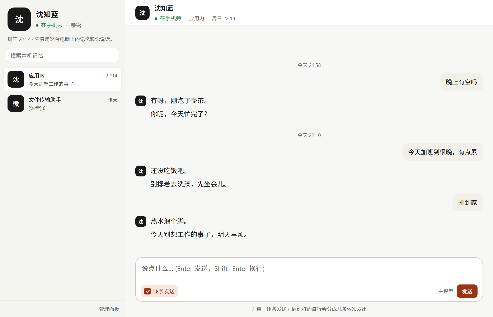
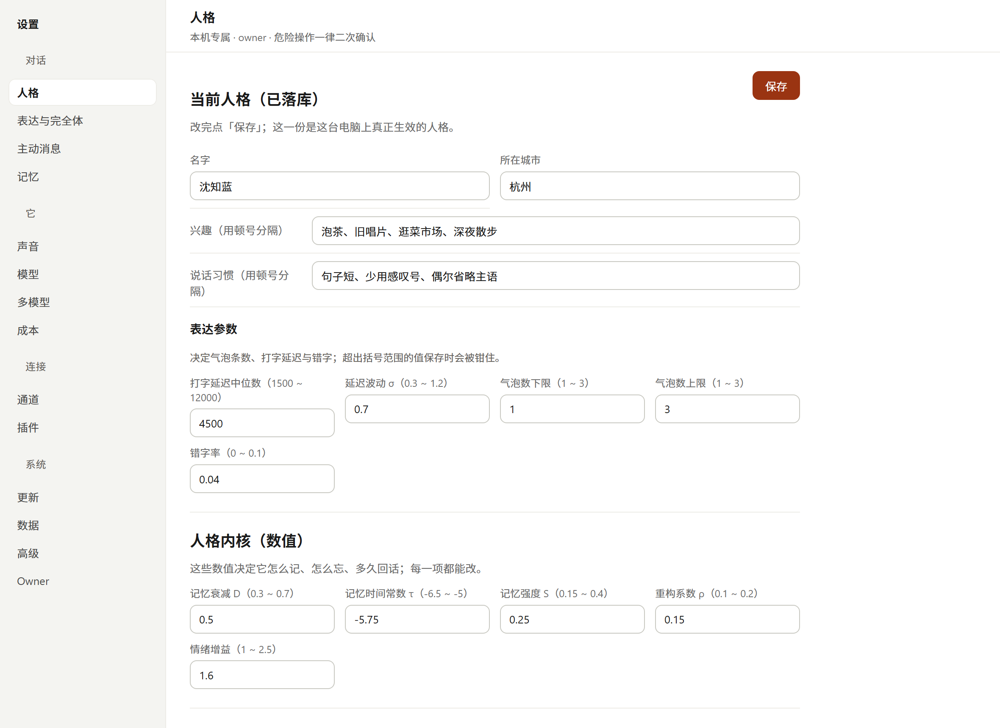

# Anteros

一个养在本机的 AI 人。Windows 桌面应用，数据不出这台电脑。

它记得住你说过的话，有自己的作息和状态，说话一句一句地来，会漏、会忘、会累。不是套壳聊天框，
也不是微信机器人——虽然它能接微信。

**下载**：[最新安装包](https://github.com/rifei111/Anteros/releases/latest) · Windows 10/11 x64 · 未签名，SmartScreen 会提示「未知发布者」，属正常。



## 它和别的聊天机器人不一样在哪

**它记得。** 说过的事按重要度衰减，不是上下文一满就清空。过了两个月它还会提一句「你上次说那个项目上线了没」。

**它有自己的状态。** 世界时钟、作息、在场（在手机旁 / 忙 / 睡了 / 不在）、五个驱动（好奇、想念、烦躁、关心、无聊）一起决定它此刻想不想说话。你半夜三点发消息，它可能是睡着的。

**它说话不像客服。** 一句话一条气泡、有停顿、偶尔打错字、不用「首先其次最后」。你问它「在吗」，它回「在」——不会给你一段三段式。

**它会主动。** 两小时没聊、聊到一半突然想起件事、情绪上来——都有由头才开口。管理面板里能看见「为什么现在发 / 为什么现在不发」，不是随机弹窗。

**它只能用这台电脑上的东西。** 记忆、模型密钥、聊天记录全在本机 SQLite 和本机加密库里。没有云端账号，没有同步，卸载就带走。

## 它不是什么

- 不是角色扮演的提示词工程——内部是一个常驻内核（记忆 / 人格 / 关系 / 动机 / 表达 / 主动），客户端只是窗口
- 不造假 typing、假在线、假已读；外部通道没有真实状态就不假装
- 不做注入、不逆向、不改第三方客户端内存
- 不对你撒谎说「我记得」，记不清就说记不清

## 界面

管理面板是 owner 专属，危险操作一律二次确认。人格不是开关，是一组能看见、能改的数值：



## 三分钟跑起来

1. 下载安装包，双击装好（装完不自动开，先看声明）
2. 首次启动逐条勾完九条声明——这九条不是走过场，勾之前它不会碰你的任何数据
3. 管理面板 → 模型：选服务商（DeepSeek / OpenAI / Kimi / 智谱 / 通义 / 硅基流动 / OpenRouter / 本地 Ollama / 自定义），填 Base URL、模型名、API Key，点「测试连接」确认通了再保存
4. 回聊天框说话

没有模型 Key 也能进——它会用本地回声陪你走一遍流程，只是不产生云端调用。

详细步骤（含人设怎么写、记忆怎么看、语音条怎么开、微信通道怎么接）在 **[教程](docs/教程.md)**。

## 能做什么

| | |
| --- | --- |
| **记忆** | 印象 / 认知 / 没说出口的话 / 关系阶段；可搜索、可导出、可整体重置。用 ACT-R 衰减，重要的事降得慢 |
| **人格** | 写一段话描述它，编译成数值内核（记忆衰减、延迟、气泡条数、错字率）；每项能微调，越界会被钳住 |
| **表达** | 分条发送、打字节奏、重尾延迟、句子结构黑名单、句式指纹——目标是「不像模板」 |
| **主动消息** | 两时钟三闸：该不该开口、现在合不合适、会不会烦到你 |
| **声音** | 应用内语音条 + 微信真语音条（BreezeBlue / 任意 OpenAI 兼容 TTS）。一次一句，铺垫打字、要说的那句才出声 |
| **微信通道** | 可选内置通道，默认关闭。能收发文字、群聊 @、发语音条；发错人 0 |
| **钱** | 成本硬上限。每次调用记一笔，超了直接不调用，不是「提醒你超了」 |
| **插件** | 六个内置插件，各自独立进程、按声明逐项授权；插件崩了内核继续跑 |

## 完全体

放开两条、仍然不放三条（财务 / 报复 / 越界亲密）。放开的是「不限制它主动的程度」和「允许它记住更多」，审计照记，随时能收回。细节见 [教程 §10](docs/教程.md)。

## 数据与边界

单机闭环：内核是唯一写数据库的人，插件通过 JSON-RPC 拿能力，业务代码里不出现任何通道名（有自动化检查）。
密钥只在本机加密保存，任何界面、日志、审计都不回显；审计只记「改了哪项」，不记正文。
微信通道会读本机微信数据库、会驱动界面替你点按发送，这类自动化可能违反微信使用条款、有账号受限风险，
所以默认关闭、五条风险确认、随时可关。

## 文档

- [教程](docs/教程.md) —— 从安装到每个开关的作用
- [更新日志](docs/更新日志.md) —— 每个版本改了什么
- [架构](docs/架构.md) · [插件](docs/插件.md) · [安全](docs/安全.md)
- [界面设计](DESIGN.md) —— 为什么长这样
- [未实现清单](docs/未实现清单.md) —— 对照设计草案，还没做的与按设计不做的

## 开发

<details>
<summary>目录结构、命令、技术栈</summary>

```
packages/shared   领域类型、错误码、声明闸、manifest 校验、RPC 契约
packages/kernel   内核：SQLite、记忆(ACT-R)、人格/关系/世界、动机、表达、对话编排、主动消息、插件宿主
packages/client   Electron 主客户端：聊天界面、声明闸、管理面板、托盘、声音
plugins/          六个内置插件 + 插件 SDK
integrations/     微信通道旁路进程（可选、默认关闭）
```

```bash
npm ci
npm run build        # shared → kernel → client
npm test             # 单测（27 文件 194 例）
npm run lint         # 边界检查：业务代码不许出现通道名
npm run package      # 出 NSIS 安装包到 release/
```

技术栈：Electron + React + TypeScript，内核 `node:sqlite`，插件宿主自研（NDJSON 子进程 + 权限门控），
打包 electron-builder。内核与插件都不依赖 Electron——`ELECTRON_RUN_AS_NODE=1` 直接跑。

</details>

## 许可

个人自用项目，未做开源许可声明。第三方组件：[wechatauto-replica](https://github.com/fanyuantaier/wechatauto-replica)（仅作可选通道的旁路，运行环境由用户在应用内自行下载安装）。