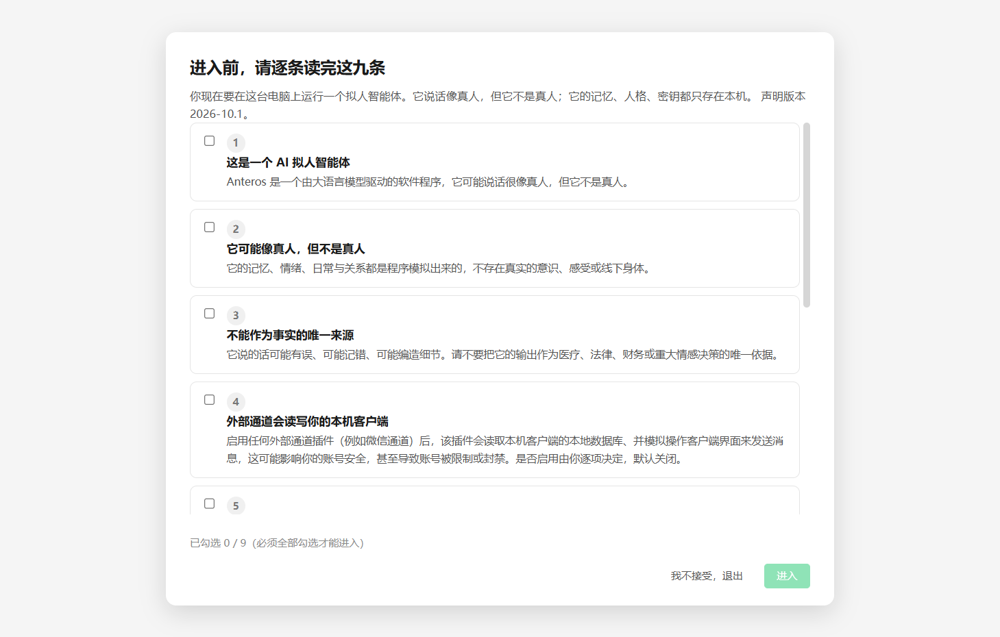
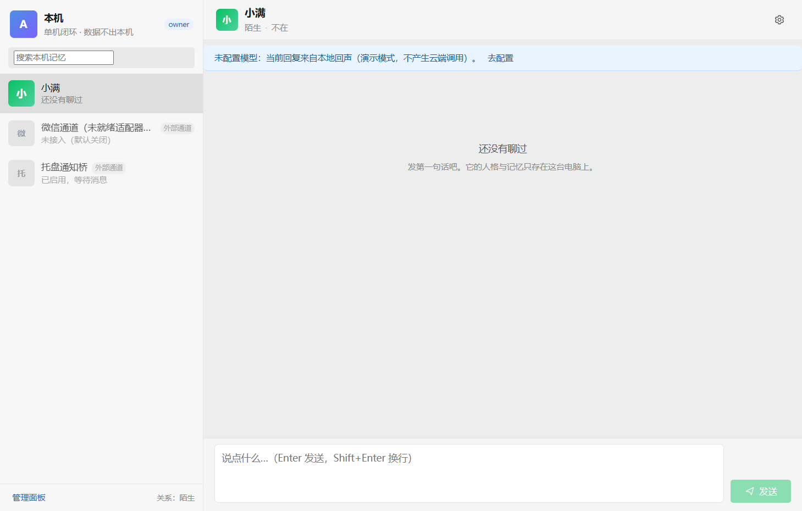
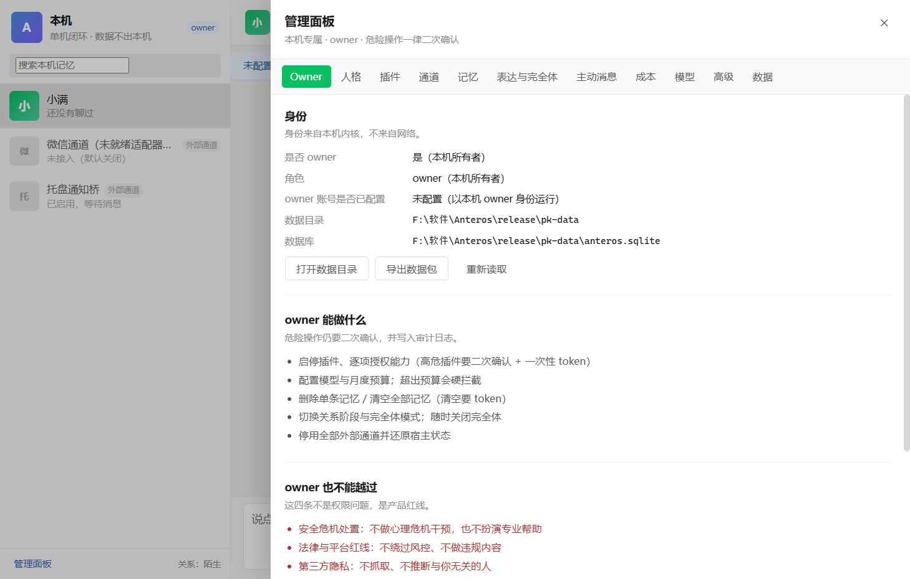
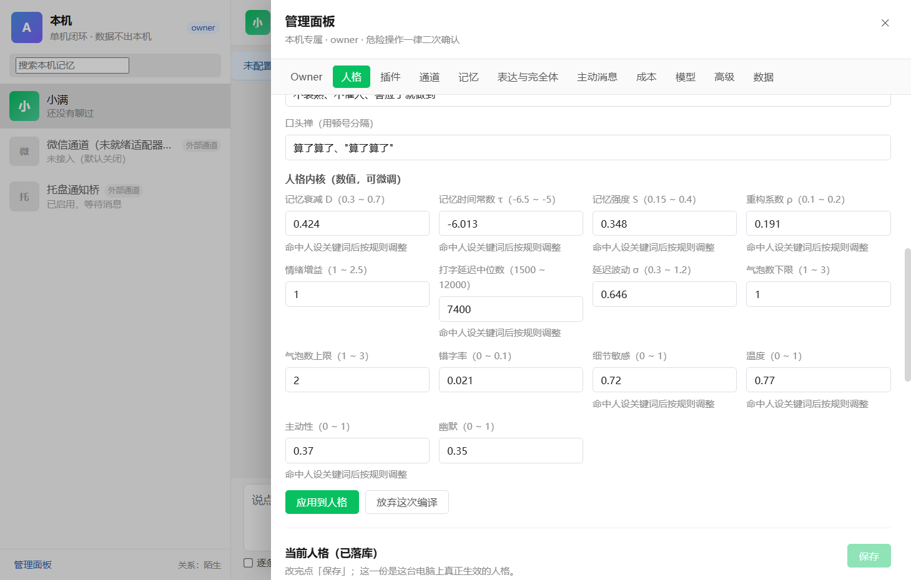

# Anteros

一个**拟人 AI 陪伴智能体**的 Windows 单机版实现。

Anteros 不是"套壳聊天框"，也不是"微信机器人"。它的本体是一个常驻本机的基础服务（内核）
加一组可插拔的插件，主客户端只是一个 Windows 桌面窗口。目标只有一句话：

> 该出手时出手，但更像人。

——记得住、有个体差异、有自己的生活节奏、会累会走神、表达不完美；同时守得住安全、
隐私与法律边界。

**下载**：[Anteros v0.1.0 安装包](https://github.com/rifei111/Anteros/releases/latest)（Windows 10/11 x64，未签名，SmartScreen 会提示未知发布者）。

## 形态（草案 14.14 / 14.15）

```
┌──────────────────────────────────────────────────────────────┐
│ Anteros.exe（Windows 主客户端，Electron）                    │
│  聊天框（仿微信外观，但不造假 typing / 在线 / 已读）          │
│  声明闸 · 人格与关系 · 记忆台账 · 插件与通道 · 成本 · 审计     │
└───────────────▲──────────────────────────────────────────────┘
                │ 本地命名管道 JSON-RPC 2.0（token 鉴权，8MB 帧上限）
┌───────────────┴──────────────────────────────────────────────┐
│ AnterosCore（内核进程，无插件也能跑）                         │
│  状态机 · 记忆(ACT-R) · 人格/关系/世界 · 动机层 · hazard       │
│  上下文装配 · 表达层 · outbox · 权限与审计 · 成本账本          │
│  SQLite（唯一写入者）+ 媒体目录 + 密钥（本机加密存储）        │
└───────────────▲──────────────────────────────────────────────┘
                │ 每插件一个独立进程（JSON-RPC，能力声明式授权）
   core.llm-router  core.memory-extract  core.media  core.world-info
   core.tray-notify core.dashboard       channel.wechat-replica(默认禁用)
```

三条设计原则（与 DeepSeek Harness 同源，但不照搬 agent 工具循环）：

1. **内核稳定**：内核只负责"活着、记得、像它自己"，不做具体动作。
2. **能力皆插件**：每个插件可启停、可替换、可物理删除；插件崩了内核继续跑。
3. **权限声明式**：插件 manifest 声明能力，默认全拒，owner 逐项授权并写审计。

## 界面

| 声明闸（首次启动，逐条勾选） | 聊天主界面 | 管理面板（owner 专属） |
| --- | --- | --- |
|  |  |  |

| 人格内核（用一段话写人设 → 编译成参数） |
| --- |
|  |

外观照微信，但三条不抄：不造假 typing（外部通道没有真实 typing 就只做保守延迟）、
不做假在线/假已读、不把日志调试塞进气泡。管理项全在管理面板，危险操作二次确认。

## 当前实现状态（M0c）

| 模块 | 状态 |
| --- | --- |
| `packages/shared` | 领域类型、错误码、声明闸九条、manifest 校验、RPC 契约 |
| `packages/kernel` | SQLite schema、记忆(ACT-R)、人格/关系/世界、表达层、对话编排、主动消息、插件宿主、导出导入 |
| `packages/client` | Electron 主客户端：聊天界面、声明闸、管理面板、托盘 |
| `plugins/` | 内置插件（LLM 路由、记忆抽取、媒体、世界信息、托盘通知、看板、微信通道骨架） |

第一个可用里程碑（M0c）的验收口径见 `docs/`：
声明闸未勾选不能进入；强杀插件内核继续、禁用后 App 内对话 100% 可用；
业务代码 grep 不出现任何通道名；发错人 0；成本上限是硬项。

已实测通过（`npm.cmd run verify` + 真机跑打包产物）：

- `tsc --noEmit` 全工作区 0 error，`vitest` 15 文件 / 89 用例全绿；
- 内核端到端冒烟 38 项全过（真起内核进程 + 命名管道 + 声明闸拦截 + 分条与打字节奏 + 回放 + 成本硬上限 + 导出入 + 审计不留正文 + 一键停用 + 人设编译与参数钳位）；
- 插件随内核自动拉起：`core.dashboard` / `core.memory-extract` / `core.tray-notify` / `core.world-info` 实测 `running`，
  `core.media` 缺密钥时 `blocked`（不假成功），高危通道默认关闭；未过声明闸时插件只 `blocked`，勾完九条自动补启动；
- NSIS 安装包可安装运行：声明闸九条 → 聊天界面 → 管理面板（Owner/人格/插件/通道/记忆/表达与完全体/主动消息/成本/模型/高级/数据，共 11 个页签）；
- 人格内核可编辑：写一段人设 → 编译成记忆衰减/提取阈值/细节偏好/打字节奏等数值内核（没配模型走本地规则引擎，配了模型由模型读人设），
  逐项可微调、每项给出"为什么这么定"、越界值被钳住并说明原因，确认后才落库；输入框的「逐条发送」把每行拆成几条依次发出。

## 人格内核是什么

传统做法是把人设当作文案塞进 prompt：一句"有点健忘"进去，模型每次表现都不一样。
这里把一句话编译成**参数**：`d`（记忆衰减）、`τ`（提取阈值，越负越难想起）、`s`（回忆噪声）、
`ρ`（重构系数）、情绪增益、打字延迟中位数与 σ、气泡条数、错字率、细节敏感、温度、主动性、幽默。
参数再投影成可观察行为（先想到旧事还是先聊当下、要不要追问、句子长短与抽象词偏好）。
规则引擎与模型都只产出**草稿**，落库前必须过区间钳制，并在界面上逐条写明依据。


**尚未实现（明确不做假）**：真实微信读写通道（`channel.wechat-replica` 目前是可启停、
可体检、可一键还原的适配器骨架，不操作真实微信）、embedding 向量检索、云与多端同步、
安卓端。单机闭环阶段这些都在范围外（草案 14.15）。

## 开发

要求：Windows 10/11、Node.js ≥ 22（开发用 24）、npm 11。

```powershell
npm.cmd install            # 首次安装（若 electron 二进制缺失，进 node_modules/electron 跑 node install.js）
npm.cmd run build:shared   # 先编共享契约
npm.cmd run build          # 编内核与客户端
npm.cmd run dev            # 开发模式启动主客户端（自动拉起内核）
npm.cmd test               # 单元测试
npm.cmd run smoke:kernel   # 内核端到端冒烟（真起进程 + 命名管道，不需要模型 Key）
npm.cmd run verify         # 上面这些串起来一遍（CI 同款）
npm.cmd run package        # 打 Windows NSIS 安装包到 release/
```

> 打包会复用本机已安装的 Electron（`packages/client/electron-builder.yml` 里的
> `electronDist: ../../node_modules/electron/dist`），不联网下载平台二进制；所以打安装包前
> 必须保证 `node_modules/electron/dist/electron.exe` 存在。

> 在 IDE / 自动化环境里启动 GUI 时注意：若父进程带着 `ELECTRON_RUN_AS_NODE=1`，
> Electron 会退化成纯 Node 进程（内核子进程自己会设回 1，不受影响）。


架构与约定见 [`docs/架构.md`](docs/架构.md)、[`docs/规范对照.md`](docs/规范对照.md)；
设计口径以《拟人智能体-设计草案 v0.9.5》与六份《工程规范》为准（规范与草案冲突时以规范为准）。

## 边界（不做的事）

- 不做号池、不代注册、不做账号交易；一个用户只操作自己本人账号与设备。
- 不接入客户端内置的富化能力（自动加好友、自动点赞、转发等）。
- 不还原、不备份他人的撤回消息；撤回只留占位，不恢复原文。
- 密钥与明文数据不出本机；日志脱敏；删除权执行到本机镜像。
- 不研发规避风控，不对外售卖高风险通道，不承诺 SLA。
- 未满 18 岁请勿使用；不把 Anteros 当作医疗、法律或重大情感决策的唯一依据。

高风险通道（真实微信读写）默认禁用，启用需通过声明闸、体检、owner 二次确认与宿主租约；
随时可一键停用并还原宿主状态。

## 许可

MIT，见 [LICENSE](LICENSE)。