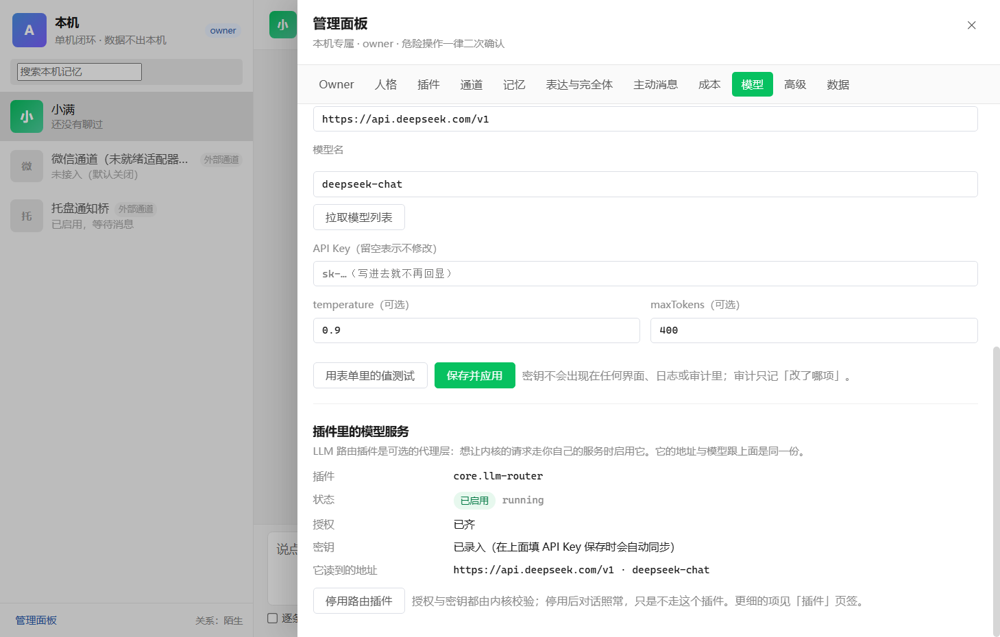
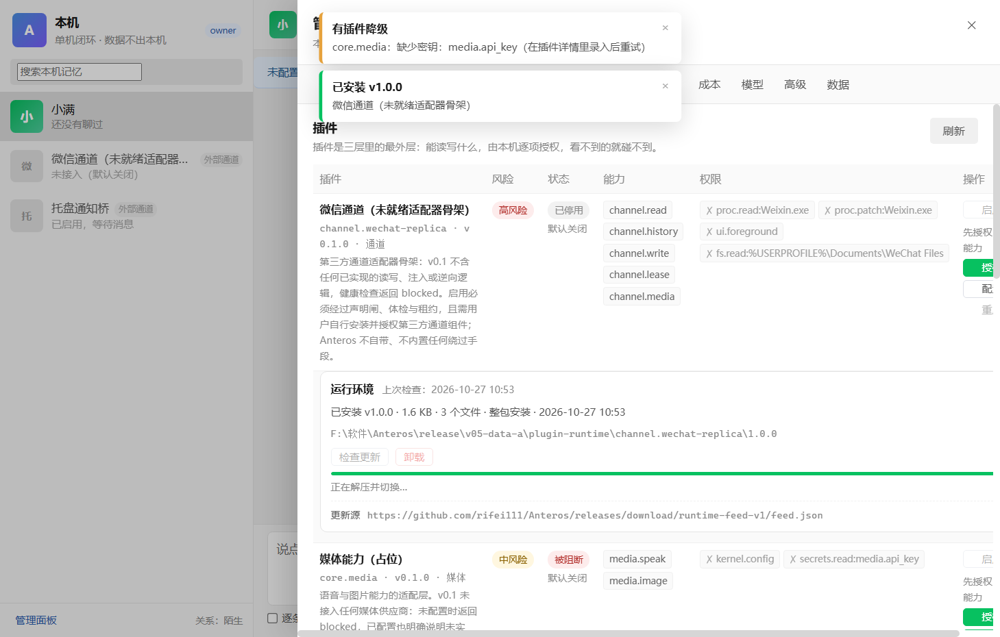
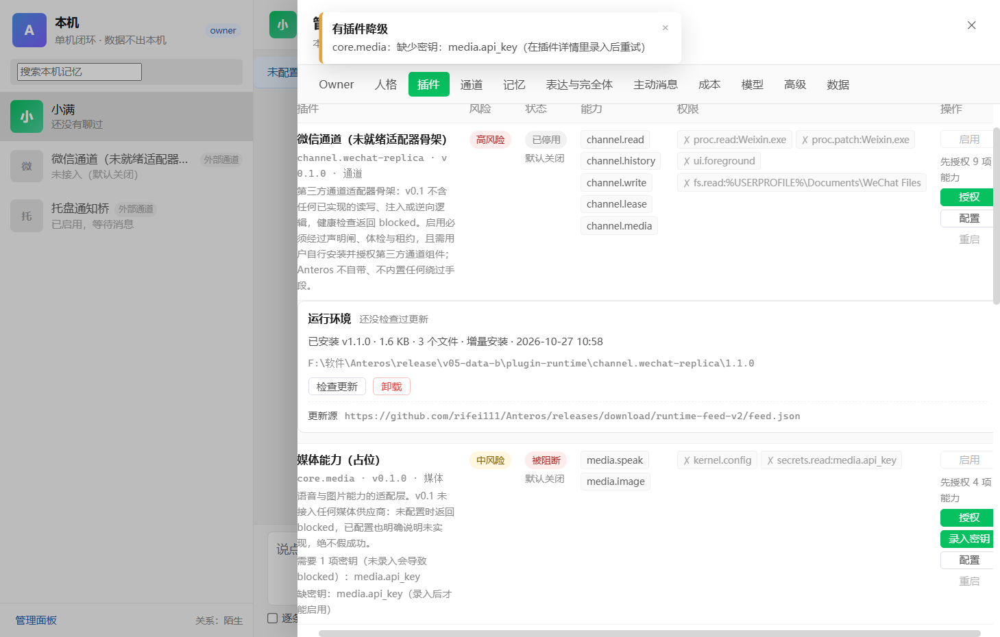

# Anteros

一个**拟人 AI 陪伴智能体**的 Windows 单机版实现。

Anteros 不是"套壳聊天框"，也不是"微信机器人"。它的本体是一个常驻本机的基础服务（内核）
加一组可插拔的插件，主客户端只是一个 Windows 桌面窗口。目标只有一句话：

> 该出手时出手，但更像人。

——记得住、有个体差异、有自己的生活节奏、会累会走神、表达不完美；同时守得住安全、
隐私与法律边界。

**下载**：[Anteros 最新安装包](https://github.com/rifei111/Anteros/releases/latest)（Windows 10/11 x64，未签名，SmartScreen 会提示未知发布者）。

## 形态（草案 14.14 / 14.15）

```
┌──────────────────────────────────────────────────────────────┐
│ Anteros.exe（Windows 主客户端，Electron）                    │
│  聊天框（仿微信外观，但不造假 typing / 在线 / 已读）          │
│  声明闸 · 人格与关系 · 记忆台账 · 插件与通道 · 成本 · 审计     │
└───────────────▲──────────────────────────────────────────────┘
                │ 本地命名管道 JSON-RPC 2.0（token 鉴权，8MB 帧上限）
┌───────────────┴──────────────────────────────────────────────┐
│ AnterosCore（内核进程，无插件也能跑）                         │
│  状态机 · 记忆(ACT-R) · 人格/关系/世界 · 动机层 · hazard       │
│  上下文装配 · 表达层 · outbox · 权限与审计 · 成本账本          │
│  SQLite（唯一写入者）+ 媒体目录 + 密钥（本机加密存储）        │
└───────────────▲──────────────────────────────────────────────┘
                │ 每插件一个独立进程（JSON-RPC，能力声明式授权）
   core.llm-router  core.memory-extract  core.media  core.world-info
   core.tray-notify core.dashboard       channel.wechat-replica(默认禁用)
```

三条设计原则（与 DeepSeek Harness 同源，但不照搬 agent 工具循环）：

1. **内核稳定**：内核只负责"活着、记得、像它自己"，不做具体动作。
2. **能力皆插件**：每个插件可启停、可替换、可物理删除；插件崩了内核继续跑。
3. **权限声明式**：插件 manifest 声明能力，默认全拒，owner 逐项授权并写审计。

## 界面

| 声明闸（首次启动，逐条勾选） | 聊天主界面 | 管理面板（owner 专属） |
| --- | --- | --- |
|  |  |  |

| 人格内核（用一段话写人设 → 编译成参数） | 模型（服务商预设 / 真探测 / 插件里的模型服务） |
| --- | --- |
|  |  |

| 运行环境：插件自己下载 | 增量更新：只下变了的文件 |
| --- | --- |
|  |  |

外观照微信，但三条不抄：不造假 typing（外部通道没有真实 typing 就只做保守延迟）、
不做假在线/假已读、不把日志调试塞进气泡。管理项全在管理面板，危险操作二次确认。

## 当前实现状态（M0c）

| 模块 | 状态 |
| --- | --- |
| `packages/shared` | 领域类型、错误码、声明闸九条、manifest 校验、RPC 契约 |
| `packages/kernel` | SQLite schema、记忆(ACT-R)、人格/关系/世界、表达层、对话编排、主动消息、插件宿主、导出导入 |
| `packages/client` | Electron 主客户端：聊天界面、声明闸、管理面板、托盘 |
| `plugins/` | 内置插件（LLM 路由、记忆抽取、媒体、世界信息、托盘通知、看板） |
| `integrations/wechatauto-sidecar` | 内置微信通道的旁路进程（可选、默认关闭；运行环境可在应用内一键下载） |

第一个可用里程碑（M0c）的验收口径见 `docs/`：
声明闸未勾选不能进入；强杀插件内核继续、禁用后 App 内对话 100% 可用；
业务代码 grep 不出现任何通道名；发错人 0；成本上限是硬项。

已实测通过（`npm.cmd run verify` + 真机跑打包产物）：

- `tsc --noEmit` 全工作区 0 error，`vitest` 17 文件 / 101 用例全绿；
- 内核端到端冒烟 71 项全过（真起内核进程 + 命名管道 + 声明闸拦截 + 分条与打字节奏 + 回放 + 成本硬上限 + 导出入 + 审计不留正文 + 一键停用 + 人设编译与参数钳位 + 插件授权/密钥/启用全链路 + 运行环境整包安装与按文件增量升级 + 内置微信通道默认关闭与风险确认闸）；
- 插件随内核自动拉起：`core.dashboard` / `core.memory-extract` / `core.tray-notify` / `core.world-info` 实测 `running`，
  `core.media` 缺密钥时 `blocked`（不假成功）；未过声明闸时插件只 `blocked`，勾完九条自动补启动；
- NSIS 安装包可安装运行：声明闸九条 → 聊天界面 → 管理面板（Owner/人格/插件/通道/记忆/表达与完全体/主动消息/成本/模型/高级/更新/数据，共 12 个页签）；
- 人格内核可编辑：写一段人设 → 编译成记忆衰减/提取阈值/细节偏好/打字节奏等数值内核（没配模型走本地规则引擎，配了模型由模型读人设），
  逐项可微调、每项给出"为什么这么定"、越界值被钳住并说明原因，确认后才落库；输入框的「逐条发送」把每行拆成几条依次发出。
- 模型页是一个页面管一件事：服务商预设（DeepSeek / OpenAI / Kimi / 智谱 GLM / 通义 / 硅基流动 / OpenRouter / 本地 Ollama / 自定义）→
  Base URL 与模型名 → 点「拉取模型列表」把服务端真返回的模型列出来选 → 「测试连接」真发一次请求（/models 不通就退回一次 1 token 对话）、
  把 HTTP 状态、延迟、失败原因（域名错、端口不对、证书、被墙）用人话说清楚 → 保存；
  **core.llm-router 插件的地址/模型/密钥也在这个页面里管**：保存时同步给插件配置与它的密钥库，
  页面下半部分直接显示它读到的地址、授权是否齐、缺哪项密钥，并可「授权并启用」——不用再去插件页签抄一遍。
- 插件授权走「按声明逐项勾选」：能力（含 `channel.lease` 租约）与权限一起列出来，高危插件还要一次性确认 token；
  声明了密钥的插件（如 `core.llm-router` 的 `llm.api_key`）在插件详情里录入密钥，**只写本机、不进日志**，录完才能启用。
- 插件运行环境在应用内自助：需要外部环境的插件卡片下多一块「运行环境」——
  点「下载运行环境」从更新源拉清单、逐个文件下到本机、校验 SHA-256、原子落盘；之后有新版本，
  点「检查更新」→「更新」**只下载变了的文件**（增量），旧版本目录保留到切换成功才删；
  更新源默认是 GitHub Release，owner 也可以换成局域网 `file:///` 或自建 https 地址。
  这条链路是「下载 → 校验 → 原子切换」的安装器，Anteros 不自带、不注入、不逆向第三方客户端。

## 内置微信通道（v0.7.0，可选、默认关闭）

微信通道不再是插件，而是软件本体的一条通道：默认关闭，你在「通道」页逐条确认风险后才开。
它把第三方开源库 [wechatauto-replica](https://github.com/fanyuantaier/wechatauto-replica)
装进一个独立的 Python 环境，再由 `integrations/wechatauto-sidecar/sidecar.py` 以父子进程管道
（一行一个 JSON，没有网络端口）把「读本机微信数据库 / 驱动微信界面发消息」这两件事交给内核。

**运行环境可以一键下载（v0.8.0）**：管理面板 →「通道」→ 微信（内置通道）→「一键下载运行环境」。
Anteros 会把官方**便携版 Python 3.11**（11MB，先校验 sha256 再解压）装到自己的数据目录
`<数据目录>/wechat-runtime/`，用它引导 pip、装好 `wechatauto-replica`。
不装系统 Python、不改 `PATH`、不写注册表；卸载时删这个目录就干净了。
也支持你自己装 64 位 Python 3.10+（勾 `Add python.exe to PATH`）——两条路都行，体检认哪个用哪个。

**除此之外还要准备两件事**：

1. Windows 10/11 64 位，**微信 4.x 桌面版**（`C:\Program Files\Tencent\Weixin\Weixin.exe`）。3.x 数据库结构不同，读不了。
2. 登录电脑版微信（必须**正在运行**，否则拿不到数据库密钥）。

然后：一键下载运行环境（或者自己装 Python 后点「安装运行依赖」）→「重新体检」五项都绿 →
「开启微信通道」→ 逐条勾完五条风险确认 → 开始工作。
只跟一个白名单会话说话（默认「文件传输助手」`filehelper`）。填会话标识时可以给三种写法：
`wxid_xxx`、`xxx@chatroom`（群）、或者**微信号**（如 `rifei111`）与昵称/备注——内核会让 sidecar
按昵称、再按微信号去联系人库里反查成 wxid，反查不到会写日志说明，不会静默读一个空会话。

**风险要说清楚**：这条通道会读本机微信数据库、会驱动微信界面代替你点按发送，这类自动化可能
违反微信使用条款、存在账号被限制的风险。所以默认关闭、五条风险确认、随时可关（关掉立刻杀子进程）。
Anteros 这边不做注入、不做内存改写、不做协议逆向，用的都是上游库公开的接口。

这条链路本身还是**单向可用**的：读与发都实装，但微信侧没有真实的 typing 与已读回执，
所以外部通道发消息只做保守延迟（不造假 typing）。

**两个曾经让通道「看着就绪、其实不回」的坑（v0.8.2 修掉）**：

1. 上游 `get_new_messages()` 返回的消息类型是中文（`文本` / `系统消息` / `图片`…），
   内核原来按 `kind === "text"` 过滤，于是**所有**消息都被当成非文本丢掉 —— 表现就是
   体检全绿、能读能发，但永远不回应。现在旁路进程先把类型归一成 `text/image/...`，
   内核再兜一层认中文写法。
2. 上游返回行里**没有 `is_self`** 字段，旁路进程按它判断「是不是自己发的」永远拿到
   `False`，于是它自己发出去的回复会被当成新消息读回来，形成自问自答。现在改成用
   发送者 wxid 和当前登录账号比对，实测「自己发的那条」被正确识别。
3. 另外，上游 `quick_send()` 每次调用都会新建一个界面驱动实例，缓存全丢，导致每条回复
   都要重新找窗口、重新搜会话（一条十几秒）。现在旁路进程复用同一个实例，并在通道开启
   时**预热**会话：实测预热 4.3 秒，之后单条发送 1.5–4.2 秒（其中 2.6 秒是上游刻意做的
   「像人一样停一下」）。

## 应用内更新（v0.6.0）

客户端自己检查更新、自己下载、自己重启安装，不用回网页下安装包：

1. 管理面板 →「更新」→「检查更新」：只读 `latest.yml`（走正式 Release，预发布不参与）。
2. 「下载」：electron-updater 用上一版安装包的 **blockmap** 做差分，只拉变了的块；
   差分失败（服务器不支持多段、缓存不在了）会自动回退整包下载，但 sha512 一直会验。
3. 「重启并安装」：静默安装、装完自动打开新版本。

几个刻意的设计：不自动下载、不静默安装（发现新版本也要你点）；升级只换程序目录，
内核、插件、记忆都在数据目录里不受影响；插件运行环境是另一套更新（插件页里那套）。

实测证据：本机起一个本地更新源，用 0.6.0 的安装包跑流程，`updater.log` 里是
`Full: 120,249.54 KB, To download: 1,840.3 KB (2%)`，最后落盘的 pending 安装包
是完整的 0.6.1——**只下了 2% 的字节**。日志同时证明差分失败会退回整包（`Cannot download
differentially, fallback to full download`），不会卡死也不会跳过校验。

## 人格内核是什么

传统做法是把人设当作文案塞进 prompt：一句"有点健忘"进去，模型每次表现都不一样。
这里把一句话编译成**参数**：`d`（记忆衰减）、`τ`（提取阈值，越负越难想起）、`s`（回忆噪声）、
`ρ`（重构系数）、情绪增益、打字延迟中位数与 σ、气泡条数、错字率、细节敏感、温度、主动性、幽默。
参数再投影成可观察行为（先想到旧事还是先聊当下、要不要追问、句子长短与抽象词偏好）。
规则引擎与模型都只产出**草稿**，落库前必须过区间钳制，并在界面上逐条写明依据。


**尚未实现（明确不做假）**：embedding 向量检索、云与多端同步、安卓端、
微信侧的富化能力（自动加好友/自动点赞/朋友圈）。单机闭环阶段这些都在范围外（草案 14.15）。

## 开发

要求：Windows 10/11、Node.js ≥ 22（开发用 24）、npm 11。

```powershell
npm.cmd install            # 首次安装（若 electron 二进制缺失，进 node_modules/electron 跑 node install.js）
npm.cmd run build:shared   # 先编共享契约
npm.cmd run build          # 编内核与客户端
npm.cmd run dev            # 开发模式启动主客户端（自动拉起内核）
npm.cmd test               # 单元测试
npm.cmd run smoke:kernel   # 内核端到端冒烟（真起进程 + 命名管道，不需要模型 Key）
npm.cmd run verify         # 上面这些串起来一遍（CI 同款）
npm.cmd run package        # 打 Windows NSIS 安装包到 release/
```

> 打包会复用本机已安装的 Electron（`packages/client/electron-builder.yml` 里的
> `electronDist: ../../node_modules/electron/dist`），不联网下载平台二进制；所以打安装包前
> 必须保证 `node_modules/electron/dist/electron.exe` 存在。

> 在 IDE / 自动化环境里启动 GUI 时注意：若父进程带着 `ELECTRON_RUN_AS_NODE=1`，
> Electron 会退化成纯 Node 进程（内核子进程自己会设回 1，不受影响）。


架构与约定见 [`docs/架构.md`](docs/架构.md)、[`docs/规范对照.md`](docs/规范对照.md)；
设计口径以《拟人智能体-设计草案 v0.9.5》与六份《工程规范》为准（规范与草案冲突时以规范为准）。

## 边界（不做的事）

- 不做号池、不代注册、不做账号交易；一个用户只操作自己本人账号与设备。
- 不接入客户端内置的富化能力（自动加好友、自动点赞、转发等）。
- 不还原、不备份他人的撤回消息；撤回只留占位，不恢复原文。
- 密钥与明文数据不出本机；日志脱敏；删除权执行到本机镜像。
- 不研发规避风控，不对外售卖高风险通道，不承诺 SLA。
- 未满 18 岁请勿使用；不把 Anteros 当作医疗、法律或重大情感决策的唯一依据。

高风险通道（真实微信读写）默认禁用，启用需通过声明闸、体检、owner 二次确认与宿主租约；
随时可一键停用并还原宿主状态。

## 许可

MIT，见 [LICENSE](LICENSE)。